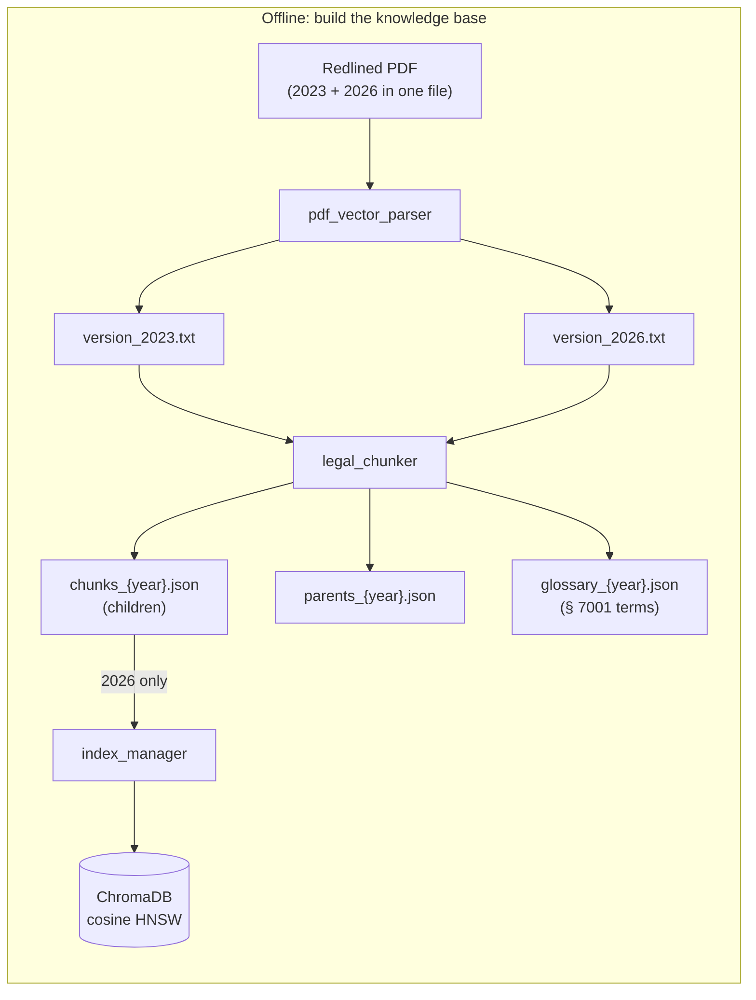
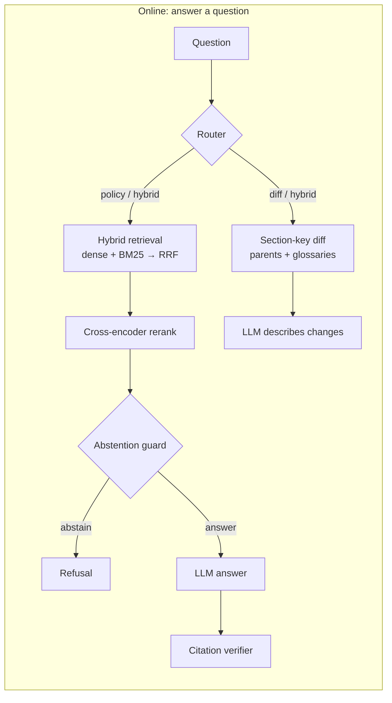
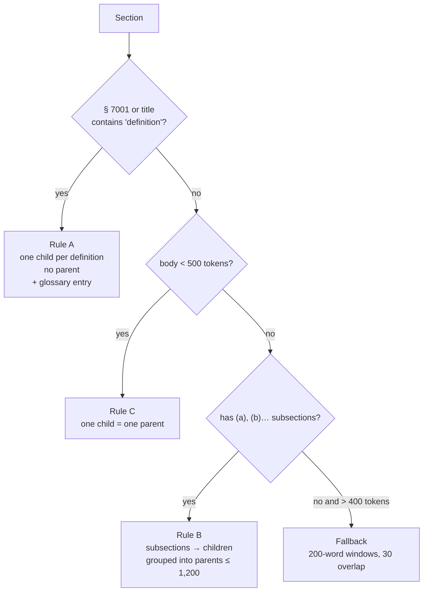
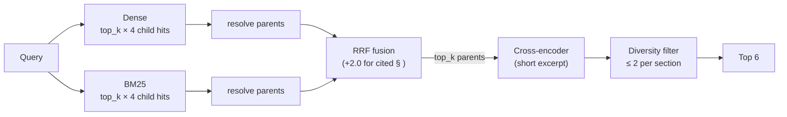
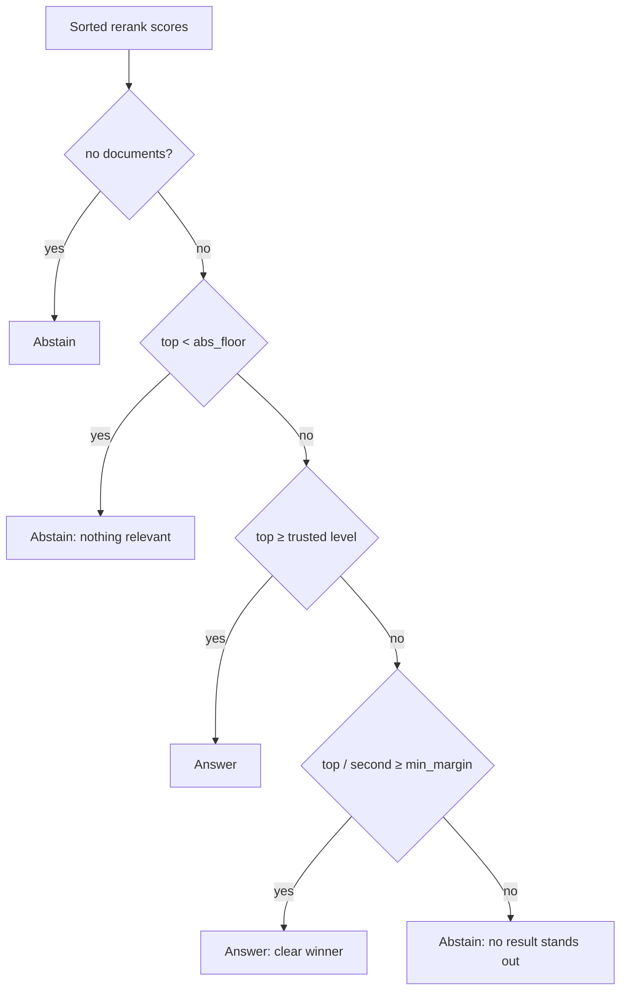

# ComplianceLens: technical deep dive

How the backend in `RAG/` works, stage by stage, and why each stage is built the way it is: **parsing → chunking → embedding and indexing → retrieval → routing → abstention → generation → citation checking → cross-version diff → monitoring → evaluation**.

This document describes the code as it is. The project overview, screenshots and run instructions are in the [main README](../README.md).

> Items marked `TODO` are numbers or facts that still have to be filled in from a real run. They are left visible on purpose rather than guessed.

**Contents**

1. [The two pipelines](#1-the-two-pipelines)
2. [Parsing the redlined PDF](#2-parsing-the-redlined-pdf)
3. [Chunking](#3-chunking)
4. [Embedding and indexing](#4-embedding-and-indexing)
5. [Retrieval](#5-retrieval)
6. [Query routing](#6-query-routing)
7. [Abstention and context selection](#7-abstention-and-context-selection)
8. [Generation](#8-generation)
9. [Citation verification](#9-citation-verification)
10. [Cross-version diff engine](#10-cross-version-diff-engine)
11. [Request lifecycle](#11-request-lifecycle)
12. [Monitoring](#12-monitoring)
13. [Evaluation](#13-evaluation)
14. [Design decisions and known limits](#14-design-decisions-and-known-limits)

---

## 1. The two pipelines

There is an **offline** pipeline that runs once per regulation text, and an **online** pipeline that runs per question. They share only the files in `data/processed/` and the Chroma collection.





The key structural decision: **the vector index contains only the current (2026) version**. The 2023 text is never searched semantically. It is reached through section numbers and glossary terms, which is what the diff engine needs (see [§10](#10-cross-version-diff-engine)).

---

## 2. Parsing the redlined PDF

**File:** `pdf_vector_parser.py`

The source is a single *redlined* PDF published by the regulator: deleted text is struck through, inserted text is underlined, unchanged text is plain. Extracting text normally would mix both versions into nonsense, so the parser reconstructs each version from the drawing layer.

### How a word is classified

PyMuPDF exposes two things per page: words with bounding boxes (`page.get_text("words")`) and vector drawings (`page.get_drawings()`). The strikethroughs and underlines are not text attributes, they are **horizontal line segments drawn over the words**.

1. `extract_horizontal_lines` collects every horizontal drawing item:
   - line items whose endpoints differ by at most 3 pt vertically, and
   - thin rectangles up to 4 pt high (some redlines are drawn as rules, not lines).
2. For each word, every line is tested. A line counts only if it **covers at least 40 %** of the word's width (`coverage_threshold=0.40`), which filters out table rules and stray strokes that merely touch a word.
3. If it covers enough, its vertical position decides:
   - passes through the middle of the word box (between 15 % from the top and 15 % from the bottom) → **strikethrough**;
   - sits along the bottom edge (from 2.5 pt above to 4 pt below the word's baseline box) → **underline**.

### How the two versions are rebuilt

| Word class | 2023 text | 2026 text |
|---|---|---|
| normal | ✓ | ✓ |
| strikethrough (deleted in 2026) | ✓ | ✗ |
| underline (added in 2026) | ✗ | ✓ |

Words are grouped into lines by `(page, block, line)` so line breaks survive, and both texts are written to `version_2023.txt` and `version_2026.txt`.

### Headers and footers

Running page headers and footers would otherwise become fake text inside sections. Words and drawings in the top 70 pt and bottom 80 pt of every page are dropped (`header_margin`, `footer_margin`). Lines in those margins are also ignored so a header rule is not mistaken for a strikethrough. The parser returns counters (`normal_words`, `strikethrough_words`, `underline_words`, `margin_words_stripped`) so a run can be sanity-checked.

**Limits.** The classification is geometric and threshold-based. A word crossed by an unrelated rule can be misclassified, and there is no ground-truth check of the output beyond manual inspection and the counters above. `TODO: record the parser counters for the shipped PDF here (pages, normal / struck / underlined / stripped words).`

---

## 3. Chunking

**File:** `legal_chunker.py` · **Schemas:** `schemas/chunks.py`

Generic fixed-size chunking breaks legal text in the worst places: it cuts a subsection in half and separates a rule from its exceptions. The chunker follows the structure of the regulation instead.

### Two kinds of chunk

| | Child chunk | Parent chunk |
|---|---|---|
| Purpose | What gets **embedded and searched** | What the LLM **reads** |
| Size | one subsection, typically ≈ 250 tokens | a group of subsections, ≤ 1,200 tokens |
| Stored in | ChromaDB (+ `chunks_{year}.json`) | `parents_{year}.json` only |

Search matches a small, focused child (sharper embedding signal). The answer is then generated from the child's whole parent, so the model sees the surrounding conditions and exceptions. Every child carries a `parent_id`.

Token counts use `tiktoken` (`cl100k_base`), with a words × 1.3 fallback if it is unavailable.

### Step 1: split into sections

The text is split wherever a line starts with `§ <number>`. The header regex `^§\s*(\d+)\.\s*([^\n]+)` extracts the section number and title. Text before the first section becomes section `0000` ("Preamble"), which downstream code ignores.

### Step 2: pick a rule per section

Rules are checked in this order:



**Rule A: definitions (§ 7001).** The definitions section is a flat list of `(a) "Term" means …`. Splitting it into sections or parents makes no sense and it is exactly the place where users ask "what does X mean". Each definition becomes its own **atomic child** (`v2026_sec7001_child_a`), with no parent, and a **glossary entry** is written alongside it:

- `term` (lower-cased), `definition_text`, `section_citation` (e.g. `§ 7001(a)`), `source_chunk_id` (joins the glossary back to the chunk),
- `aliases` (the upper-cased term when it is five characters or fewer, so `ADMT` matches),
- `is_distinctive`: true for multi-word terms and a few known acronyms (`admt`, `coppa`, `ccpa`). Single common words like *business* or *consumer* are marked non-distinctive so they do not hijack ordinary questions (see [§10](#10-cross-version-diff-engine)).

Because these chunks have no parent, the retriever resolves them through the glossary instead (see [§5](#5-retrieval)). This is the fix for the early failure where definition queries missed: chunks without a resolvable parent were silently dropped.

**Rule C: micro sections.** A section under 500 tokens is kept whole: one child (`…_child_all`) whose parent has the same text. Splitting it would only lose context.

**Rule B: standard sections.** The body is split at top-level subsection markers `\n(a)`, `\n(b)`, … Subsections are packed greedily into parents until adding the next one would exceed **1,200 tokens**. Each subsection becomes a child, prefixed with `§ <number>. <title>` so a child is self-describing when retrieved on its own (`v2026_sec7025_p2_c3` = section 7025, second parent, third child).

**Fallback.** If a long section (over 400 tokens) has no recognisable subsections, it is cut into 200-word windows with 30 words of overlap under a single parent, and each child is flagged `is_fallback_split=True`.

**Uniqueness guard.** After chunking, duplicate `chunk_id`s are dropped with a warning, because Chroma upserts by ID and a silent collision would overwrite a chunk.

### Honest notes on sizes

The 400-token child limit is enforced only by the fallback rule. A single subsection longer than 400 tokens stays one child, and a single subsection longer than 1,200 tokens becomes its own parent. These cases are counted rather than hidden: `stats.py` reports how many children exceed 400 tokens.

### Output

Running the chunker for each version writes `chunks_{year}.json`, `parents_{year}.json` and `glossary_{year}.json` into `data/processed/`.

| | 2023 | 2026 |
|---|---|---|
| Child chunks | `TODO` | `TODO` |
| Parent chunks | `TODO` | `TODO` |
| Glossary terms | `TODO` | `TODO` |
| Child tokens (median / p95 / max) | `TODO` | `TODO` |
| Parent tokens (median / p95 / max) | `TODO` | `TODO` |
| Children > 400 tokens | `TODO` | `TODO` |
| Fallback-split children | `TODO` | `TODO` |

`TODO: fill from python stats.py`

---

## 4. Embedding and indexing

**Files:** `embeddings.py`, `index_manager.py`, `config.py`

### Embedding adapter

`get_embedding_function()` builds the provider named in `EMBEDDING_PROVIDER` (`gemini` by default; `openai`, `huggingface` and `ollama` are supported too) and wraps it in `LangChainEmbeddingAdapter`.

The adapter exists because two libraries need the same embedder through different interfaces:

- ChromaDB calls it as a function (`__call__`) when you upsert documents.
- LangChain's `Chroma` wrapper calls `embed_documents` / `embed_query` when you search.

One adapter implements both, so **indexing and querying are guaranteed to use the same model and dimensionality**. It also normalises inputs (strings, nested lists) and outputs (numpy arrays → plain float lists), reports a stable `name()` so Chroma can detect an embedding-model mismatch on an existing collection, and retries on HTTP 429 with a linear back-off (10 s × attempt, up to 5 attempts).

Gemini embeddings are truncated to `EMBEDDING_DIMENSION` (768) via `output_dimensionality`. Documents go through `embed_documents` and queries through `embed_query`, so a provider that distinguishes document and query task types applies the right one on each side.

### Index

`VectorIndexManager` connects to the Chroma **server** (`chromadb.HttpClient`, its own container in Compose) and creates the collection with `{"hnsw:space": "cosine"}`.

- **What is indexed:** child chunks only. Chroma stores `text` as the document and every other field (`parent_id`, `version`, `section`, `sub_item`, `section_title`, …) as flat metadata, with `None` values removed.
- **Which version:** `chunks_2026.json` (see [§1](#1-the-two-pipelines)).
- **Rate limiting:** the Gemini embedding quota is ~100 requests/minute, so the indexer upserts **10 chunks every 6 s**. If a batch still hits a 429 it waits 45 s and retries up to 5 times before failing loudly.
- **Idempotent:** `upsert` by `chunk_id`, so re-running does not duplicate. `delete_version(tag)` removes everything for one regulation version via a metadata filter.

Provider and model names live in `.env`; changing the embedding model requires re-indexing because vectors from different models are not comparable.

---

## 5. Retrieval

**Files:** `retriever.py`, `hybrid.py`, `reranker.py`

Retrieval has three stages: two independent candidate generators, a fusion step, and a cross-encoder that re-judges the survivors.



### 5.1 Dense retrieval: child hit, parent returned

`ParentChildRetriever` embeds the query, asks Chroma for the nearest **children**, and turns them into **parents**:

1. Collect distinct `parent_id`s in rank order.
2. Look each one up in an in-memory `parents_db` (loaded from `parents_*.json`, so no database call).
3. Keep the text of the **best-matching child** for each parent as `matched_excerpt`. This is used later by the reranker.
4. § 7001 definition chunks have no parent file. `parents_db` also registers every glossary entry as a synthetic parent (`section: 7001`, text = the definition), so definition hits resolve like everything else.

A retry loop handles 429 responses from the embedding API.

### 5.2 Sparse retrieval: BM25

Pure semantic search is weak on exactly the things lawyers type: section numbers, defined terms, rare phrases. `HybridRetriever` therefore also builds a BM25 index (`rank_bm25.BM25Okapi`) over all child chunks held in `chunks_*.json`.

Each child is indexed as `§ <section> <title> <text>`, so a query that says "7025" or names a section title matches lexically even when the chunk body never repeats it. The tokenizer is a plain lowercase `\b\w+\b`, deliberately simple and deterministic. Hits are resolved to parents the same way as dense hits.

> `TODO(verify)`: BM25 loads *every* `chunks_*.json` (2023 and 2026) while Chroma holds only 2026. Confirm that the policy path restricts results to the 2026 version (`version_filter="2026"`), otherwise 2023 sections could enter policy answers through the BM25 arm.

### 5.3 Reciprocal Rank Fusion

Dense and BM25 scores live on different scales, so scores are not combined; **ranks** are. For every parent:

```
rrf(parent) = Σ over lists  1 / (60 + rank)
```

A parent that appears high in both lists beats one that is first in only one. On top of that, if the question explicitly cites a section (`§ 7025`, `section 7025`), parents of that section get **+2.0**, which is larger than any possible RRF sum (the maximum is about 0.033), so an explicit citation always puts that section on top.

**Fan-out.** Both arms search `top_k × 4` child chunks. An earlier version searched a fixed 5 children on the dense side against 4 × top_k on the BM25 side, so the fused pool was mostly BM25 and queries phrased without the regulation's vocabulary lost to lexical matches. Balancing the two arms fixed that.

### 5.4 Cross-encoder reranking

Fusion ranks are cheap and coarse. A cross-encoder (`FlashRank`, `ms-marco-MiniLM-L-12-v2`) reads the query and a passage **together** and gives a much better relevance judgement, at higher cost, so it only sees the fused candidate pool (20 to 25 parents).

**The 512-token problem.** The model scores a `[query, passage]` pair and silently truncates the pair to 512 tokens, keeping the beginning. Parents are up to ~1,200 tokens, so the second half of a long section was discarded **before scoring**, and the correct section was often the one whose relevant sentence sat in the discarded half. The fix is on our side, because the limit is the model's position embeddings:

> Rerank `§ <number> <title>` plus the **`matched_excerpt`** (the child that actually matched) instead of the whole parent. If no excerpt is available, fall back to the first 1,600 characters of the parent. The full parent is still what the LLM receives.

**Section diversity.** After reranking the top 15, `rerank_with_diversity` keeps at most **2 parents per section** until 6 are selected. Without it, one long section with many sub-parts can occupy the whole context window and crowd out the other section that a multi-part question needs.

Each returned document carries `rerank_score` in its metadata. The abstention guard reads that.

---

## 6. Query routing

**File:** `router.py`

A question is sent to one of three routes:

| Route | Meaning | Retrieval |
|---|---|---|
| `POLICY_LOOKUP` | what the current rules are | hybrid retrieval over 2026 |
| `VERSION_DIFF` | what changed between 2023 and 2026 | diff engine, no vector search |
| `HYBRID_BOTH` | needs the current rule *and* its history | policy retrieval, plus a changelog block appended to the context |

The **default router is heuristic and makes no API call**:

- `VERSION_DIFF` (confidence 0.95) if the query contains a diff phrase (`was/were added|removed|amended…`, `new/old/previous version`, `compared to/with`, `before and after`, `since 2023`), **or** at least two diff keywords (`change`, `amend`, `update`, `compare`, `previous`, `2023`, …), **or** both `2023` and `2026`, **or** "what changed".
- `HYBRID_BOTH` (0.80) if exactly one diff keyword is present, because a single word like "updated" is ambiguous.
- Otherwise `POLICY_LOOKUP` (0.90), scoped to 2026.

The router also extracts explicit section numbers (`§ 7025`, `Section 7025`) from the query. They feed the citation boost in retrieval and the section selection in the diff engine.

An **LLM router** is available behind a flag (`use_llm_router`): structured output into the same `QueryRoutingDecision` schema, falling back to the heuristic on any failure. The heuristic is the default because routing is a cheap, testable decision and each LLM call adds latency and cost. `TODO: report routing accuracy on the golden set (the harness measures it).`

---

## 7. Abstention and context selection

**File:** `abstention.py`

Two separate decisions are made after reranking.

### 7.1 Should we answer at all?

The cross-encoder's raw scores are **not calibrated probabilities**. On dense legal text they are compressed: a clearly correct top passage can score ~0.06 while irrelevant neighbours score ~0.007, so no single absolute threshold works. What *is* stable is the **shape**: a relevant question produces one passage that separates from the rest, an out-of-scope question produces a low, flat pile.

`AbstentionGuard.evaluate_retrieval` therefore combines three signals:



| Parameter | Code default | Role |
|---|---|---|
| `abs_floor` | 0.01 | below this nothing is relevant, always abstain |
| `min_rerank_score` (trusted level) | 0.35 | at or above this, answer without a margin check |
| `min_margin` | 1.5 | between floor and trusted level, require top ≥ 1.5 × runner-up |

The pipeline passes a per-request trusted level: **0.35 when the question cites a section, 0.22 otherwise** (a section-cited question has a strong anchor, so a higher bar is reasonable; uncited questions score lower naturally). `TODO(verify): confirm the 0.35 / 0.22 split matches pipeline.py, and write the final abs_floor / min_margin / keep ratio / min docs actually in use (the table shows the code defaults; the shipped values were tuned by hand, see §13).`

Every decision returns the score, the margin and a human-readable `reason`, which end up in the API response and the trace.

### 7.2 Which passages reach the LLM?

`select_context` keeps the top `min_context_docs` (2) plus any further passage scoring at least `relative_keep_ratio` (0.2) × the top score. Because the cutoff is **relative to the top score**, it adapts to the compressed scale: a correct top passage with a score of 0.06 still keeps its useful neighbours and drops the noise tail, which an absolute cutoff could not do.

### 7.3 Relevance is not answerability

The score only measures topical similarity. "How much does a CCPA audit cost?" retrieves the audit sections with a **high** score, but the regulations say nothing about price. No retrieval threshold can separate that from a real question. That is the job of the generation layer (next section), and it is why the evaluation counts refusals from both layers.

---

## 8. Generation

**Files:** `prompt_templates.py`, `llm_service.py`

`get_prompt_template(route)` returns one of three templates (policy, diff, hybrid). All of them enforce the same rules: answer **only** from the provided context, cite section numbers, and say so explicitly when the context does not contain the answer (the "Honest Scope" rule). That rule is the second abstention layer from [§7.3](#73-relevance-is-not-answerability).

Context is formatted as numbered blocks so the model can cite them:

```
[Source 2 | Section § 7051 | Contract Requirements for Service Providers… | Ref: v2026_sec7051_p1]
<full parent text>
```

`llm_service.get_llm()` is a provider factory (Gemini by default; the model comes from `LLM_MODEL`). Gemini clients are created with 6 retries and a 60 s timeout. The cross-version engine calls the model at temperature 0.1; the evaluation judge runs at 0 for reproducibility.

---

## 9. Citation verification

**File:** `citation_verifier.py`

After generation, the answer is scanned for section references (`§ 7013`, `Section 7013`, `Sec. 7013`; four-digit numbers with an optional letter). Each cited section must be present in the context the model was given, either in a document's `section` metadata or mentioned in its text.

The output is `is_valid`, a score (valid / cited), and the lists of valid and hallucinated citations. An answer with no citations passes.

**What this guarantees and what it doesn't.** It catches the specific failure of *inventing a section number that was never retrieved*. It does not prove that a cited section supports the sentence it is attached to; that kind of semantic faithfulness is what the LLM judge in the evaluation measures instead.

---

## 10. Cross-version diff engine

**File:** `section_key_rag.py`

The flagship feature. The idea: **do not ask a model what changed, compute it.**

Amendments to a regulation almost never move text across section boundaries, so the 2023 and 2026 versions can be joined by section number. The engine builds the comparison deterministically and the LLM only *describes* a difference it is handed.

### Inputs

- `parents_2023.json`, `parents_2026.json` → `{section number: [parent chunks]}`
- `glossary_2023.json`, `glossary_2026.json` → `{term: definition}` (aliases indexed too)

### Resolving a query to comparable text

`build_context()` runs **no LLM call**. It resolves the query to sections and/or terms in this order:

1. Sections named explicitly (from the router, or by regex).
2. Defined terms the query mentions (§ 7001, below).
3. If neither: vector discovery over the 2026 index, mapping hits back to sections or terms. In the `HYBRID_BOTH` path the pipeline passes in the documents it already retrieved, so no second search happens.

### Standard sections

For each section, the engine places the full 2023 and 2026 text next to each other under a header that says what happened:

| State | Header tag |
|---|---|
| in both | `2023 BASELINE TEXT` / `2026 UPDATED TEXT` |
| only in 2026 | `NEWLY ENACTED SECTION IN 2026` |
| only in 2023 | `REPEALED / DELETED SECTION IN 2026` |

Added and removed sections therefore come from set logic, not from the model's memory.

### Definitions (§ 7001) are compared term by term

§ 7001 is one huge section where nearly everything is re-lettered when a single definition is added, so comparing it as a block reports changes that did not happen. Instead:

- **Term matching.** A query is scanned for defined terms with whole-word matching (plurals tolerated: *requests to delete* matches *request to delete*), longest match wins. Terms flagged non-distinctive (*business*, *consumer*, …) only count when the query is clearly asking for a definition ("define", "meaning", "means"), otherwise almost every question would match them.
- **Normalised comparison.** Definition text is compared with its `(a)` lettering, whitespace, case and quote style removed, so a pure re-lettering is reported as *unchanged wording, changed citation* rather than as a change.
- **Tags:** `WORDING UNCHANGED`, `WORDING UNCHANGED - CITATION CHANGED`, `WORDING CHANGED`, `NEWLY DEFINED TERM IN 2026`, `DELETED DEFINITION IN 2026`.
- **Whole-§ 7001 queries** ("what changed in § 7001?") get a deterministic **overview** computed from the two glossaries: counts and names of added, removed and changed terms, plus full text for the first 15.
- **Retrieved chunk → term.** If the question reached § 7001 through retrieval, the chunk is joined to its glossary term through `source_chunk_id`, falling back to text containment.

### Generation

One LLM call receives the side-by-side context and is told to base the answer strictly on it, to cite sections and term names, and to state explicitly when something did not change. If the query cannot be resolved to any section or term, the engine returns an abstention without calling the model.

### Where it plugs in

- `VERSION_DIFF` → the engine answers on its own. Retrieval relevance scores are not used (the sections are joined by key), so the response reports a confidence of 1.0 with a reason that says so.
- `HYBRID_BOTH` → the normal policy answer is generated, with a changelog block for the same sections appended to the context.

---

## 11. Request lifecycle

**File:** `pipeline.py` (`RAGPipeline.query`)

```
1. route the query                               → route, extracted sections
2. VERSION_DIFF?   → diff engine → answer        (done)
3. hybrid retrieval  (top_k = 20 with a cited section, else 25)
4. cross-encoder rerank, ≤ 2 per section, keep 6
5. abstention guard → refuse with reason         (done)
6. select context (relative cutoff)
7. HYBRID_BOTH?    → append changelog block
8. generate the answer from the route's prompt
9. verify citations
10. return answer, routing decision, abstention decision,
    citation report and source documents
```

The response object (`RAGResponse`) carries the answer plus the full decision trail (routing, abstention score and margin, citation audit, sources), so the UI and the evaluation read the same fields. On abstention, `source_documents` is empty: unrelated sections are never shown as if they supported an answer.

`TODO(verify): the numbers in step 3 and 4 come from pipeline.py. Re-check them against the file in the repo.`

### Serving

The expensive parts of `RAGPipeline` are loading the parent maps, building the BM25 index and loading the reranker model, so the API builds it **once**: the FastAPI `lifespan` hook calls `get_pipeline()` at startup (warming the models and the Chroma connection) and the `/query` route receives the same instance through dependency injection. On shutdown the hook flushes buffered Langfuse traces so none are lost.

| Method | Path | Purpose |
|---|---|---|
| `GET` | `/api/v1/health` | liveness: `status`, `version`, `timestamp` |
| `POST` | `/api/v1/query` | the unified endpoint: routes, retrieves, answers or refuses |
| `GET` | `/` | pointer to the interactive docs at `/docs` |

**Request** (`POST /api/v1/query`)

```json
{
  "query": "What was changed concerning Opt-out Preference Signals between 2023 and 2026?",
  "tags": ["api-production"],
  "metadata": { "user_id": "usr_123" }
}
```

`query` is required (at least 3 characters). `tags` and `metadata` are optional and are attached to the Langfuse trace (defaults: tag `api`, empty metadata).

**Response**

| Field | Meaning |
|---|---|
| `query` | the original question |
| `answer` | the generated answer, or the refusal text |
| `route` / `route_reasoning` | the router's decision and why |
| `abstained` | true if the system refused (retrieval guard or no comparable sections found) |
| `citation_valid` | true if every cited section was present in the context |
| `sources` | the passages shown as support (empty on a refusal) |
| `execution_time_sec` | end-to-end latency measured in the route handler |

The route is a plain synchronous function, so FastAPI runs it in its worker thread pool and a slow request does not block the event loop. Any exception becomes an HTTP 500 with the error message in `detail`. CORS is open (`*`) for development; restrict `allow_origins` for a real deployment.

The API response is a deliberately smaller view of the internal `RAGResponse`: it hides the abstention score, margin and per-source rerank scores. Those remain available in the Langfuse trace and to the evaluation harness, which calls the pipeline directly.

`TODO(verify): the last sentence assumes the harness calls RAGPipeline directly, not the HTTP API.`

---

## 12. Monitoring

**Stack:** Langfuse v3, run from `docker-compose.monitoring.yml`, separate from the application stack (web UI on `:3000`, worker, PostgreSQL, ClickHouse, Redis, MinIO).

Instrumentation is in `pipeline.py` and is a no-op when `LANGFUSE_ENABLED` is false, so the application never depends on it:

- `@observe` wraps `RAGPipeline.query`, producing one trace per question.
- A LangChain `CallbackHandler` scoped to that trace captures every LLM call (prompt, completion, tokens, latency) as nested observations.
- The trace is enriched with tags, caller metadata, the chosen **route**, the **extracted sections**, and the final output including whether the request **abstained**.

This answers the questions that come up when debugging: which route did this question take, what did retrieval return, what did the model see, and why did it (not) answer. The retrieval scores and abstention reasons travel in the response and in the trace.

`TODO: add a screenshot of one trace (docs/screenshots/langfuse-trace.png) and a latency summary (p50 / p95) from real traffic.`

---

## 13. Evaluation

**Files:** `eval_harness.py`, `eval_retrieval_tuning.py`, `golden_dataset.json`

### Golden dataset

Each record has an `id`, `query`, `query_type`, `answerable`, the expected `section`, a `ground_truth_answer`, an optional `target_term` (for definition questions) and `key_terms`. Unanswerable (out-of-scope) questions carry a ground truth that is a refusal. They include questions that **sound** in scope (for example the cost of an audit) because those are the ones a retrieval threshold cannot catch.

`TODO: counts by query_type, answerable vs. out-of-scope (31 out-of-scope at last count), and how the questions were written (generated from the text, then reviewed / hand-written).`

### Metrics

| Metric | What it measures |
|---|---|
| **Section Hit Rate / Recall@K** | The correct section is present in the final context |
| **Hit@1** | The correct section is ranked first |
| **Context Precision@K** | Share of the final context that is relevant |
| **False abstention rate** | Answerable questions that were refused |
| **Out-of-scope abstention rate** | Unanswerable questions that were refused, by the retrieval guard **or** by the model |
| **Citation validity** | Answers whose cited sections were all in context |
| **Key-term recall** | Required terms present in the answer |
| **Semantic similarity** | Embedding similarity of answer vs. ground truth |
| **LLM-judge score (1-5)** | Faithfulness and correctness against the ground truth, temperature 0 |
| **Routing accuracy** | Route chosen vs. expected |

**Counting model refusals.** For an out-of-scope question, a refusal can come from the retrieval guard or from the model after retrieval. The harness lets the judge score non-abstained answers to out-of-scope questions against the refusal ground truth, and a judge score of 4 or more counts as a refusal. The number of such model-level refusals is reported separately (`out_of_scope_model_refusals`), so it is visible how much of the out-of-scope behaviour comes from the prompt rather than the guard. The judge's mean is computed over answerable questions only.

### How the shipped parameters were chosen

The abstention and context-selection values in [§7](#7-abstention-and-context-selection) were tuned **by hand**, in an early round on a small sample (about 20 questions) of the golden dataset. That round happened **before** the out-of-scope questions were added, so it tuned the guard against answerable questions only. The evaluation runs reported in this document are separate: each takes a **random sample of 150 questions** from the full golden dataset. The tuning questions were not recorded as a split, so overlap between the two is possible but, with a ~20-question tuning set drawn from a much larger pool, unlikely to be large.

### Re-tuning without spending API calls

`eval_retrieval_tuning.py --sweep` is the repeatable way to re-tune if the corpus, the reranker or the embedding model changes. It replays **recorded** retrieval results offline over a grid of `abs_floor`, `min_margin`, `relative_keep_ratio` and `min_context_docs`. Every question is classified as **hit** (right section kept), **cut** (right section retrieved but removed by context selection) or **MISS** (never retrieved), which separates a parameter problem from a retrieval problem. Because it replays stored scores, a sweep takes seconds and uses no API quota.

### Results

`TODO: paste the final run (see main README table). Report each metric with its sample size: every percentage here comes from a small set, so a single question moves it by about 1 point. Add the date, the model names (LLM, embeddings, judge) and the commit.`

### Caveats

- **No formal hold-out split.** The thresholds were tuned on a small early sample and the reported runs are random 150-question samples of the full set, so the tuning questions are probably, but not provably, absent from them. The out-of-scope questions were added after tuning, so the abstention behaviour on them was **not** tuned for. A recorded split (tuning set vs. evaluation set, fixed seed) would make the figures cleaner.
- **Samples are small.** A single question moves a percentage by about one point on 150 questions and by more on the out-of-scope subset.
- The judge is itself an LLM; it was spot-checked by hand on refusals and answers (they looked correct) but it was not calibrated against human labels.
- The diff feature is checked on a separate set. `TODO: add its results if they are to be shown here.`

---

## 14. Design decisions and known limits

### Decisions

| Decision | Why |
|---|---|
| Embed small children, answer from large parents | Sharp matching, complete context |
| Chunk by legal structure, not by size | Rules and their exceptions stay together |
| Definitions as atomic chunks + glossary | Definition questions are frequent and the section is unusable as one block |
| Hybrid retrieval | Section numbers and defined terms need lexical match; paraphrased questions need semantic match |
| Rerank an excerpt, not the parent | The cross-encoder silently truncates at 512 tokens |
| Relative abstention and context selection | Cross-encoder scores are not calibrated |
| Section-key join for diffs | Changes do not cross section boundaries; set logic is exact, model recall is not |
| Chroma in its own container; Langfuse in a separate Compose file | Each can be restarted or upgraded without touching the rest |

### Known limits

- **Citation checking is structural**, not semantic ([§9](#9-citation-verification)).
- **Retrieval relevance is not answerability**; refusals for plausible-but-out-of-scope questions rely on the model following the grounded-only prompt, which is measured but not guaranteed.
- **Evaluation sample sizes are small** and not held out ([§13](#13-evaluation)).
- **Only the 2026 version is searchable by meaning.** A question that needs to *find* a 2023-only concept by description (rather than by section number or term) is not served by vector search.
- **The parser is geometric**; an unusual redline style would need new thresholds ([§2](#2-parsing-the-redlined-pdf)).
- **Heuristic router**: phrasing outside its phrase list and keyword list falls through to a policy lookup. The LLM router is available but off by default.
- **Single regulation.** The structure rules (`§ NNNN`, `(a)` subsections) are specific to the CCPA regulation format.

---

## Reproducing the build

```bash
# 1. Parse the redlined PDF into version_2023.txt / version_2026.txt        TODO: module path
# 2. Chunk both versions → chunks_/parents_/glossary_{year}.json             TODO: module path
# 3. Index the 2026 children into Chroma (rate limited: ~10 chunks / 6 s)    TODO: module path
# 4. Evaluate:        python eval_harness.py   TODO: flags
# 5. Tune offline:    python eval_retrieval_tuning.py --sweep
```

`TODO: replace with the exact commands and confirm the order against the main README's "Run it" section.`