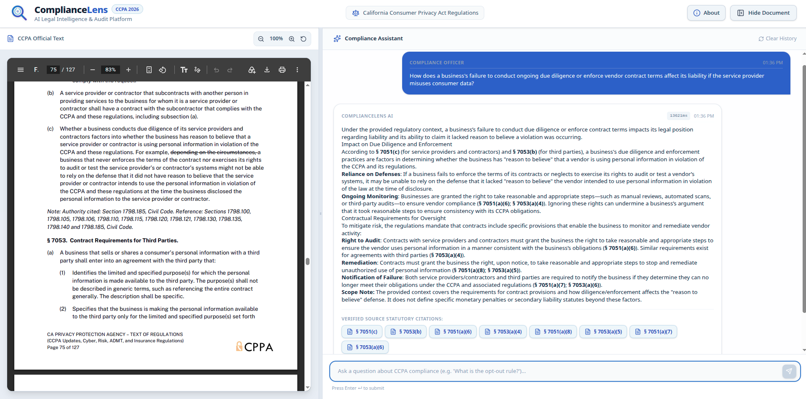
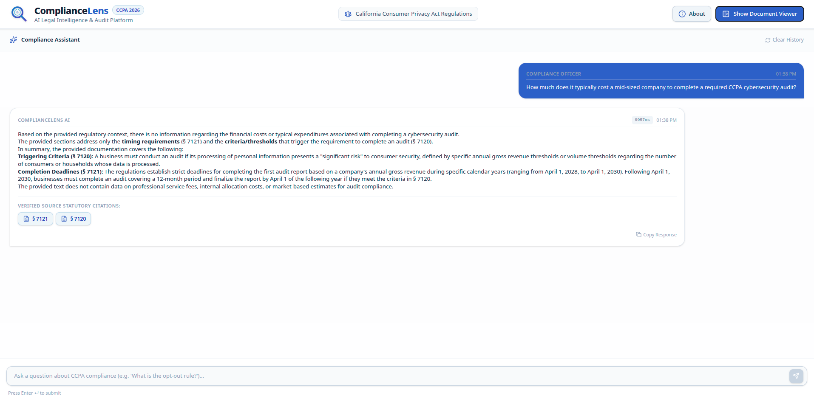
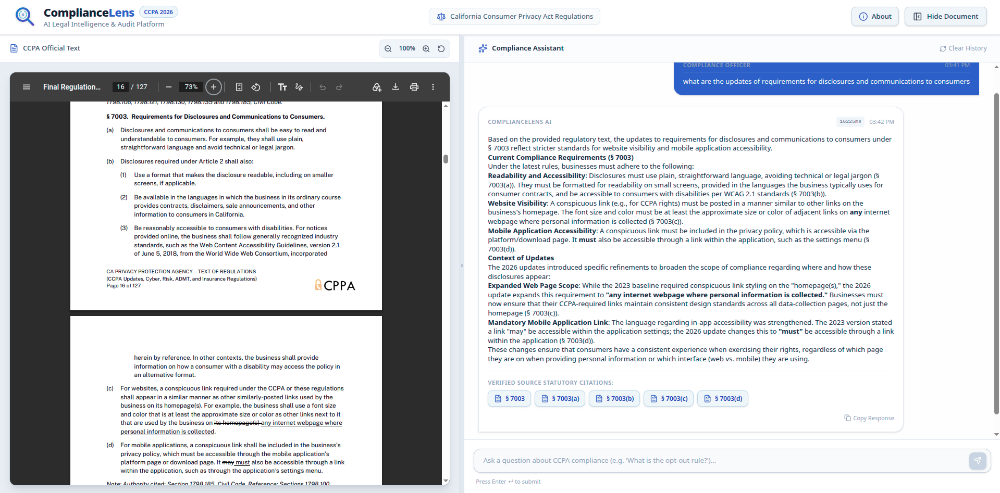
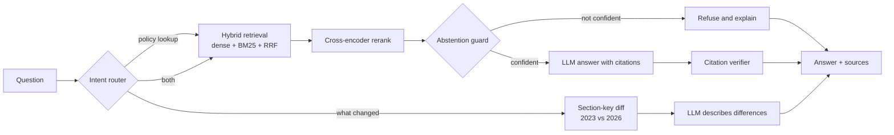

<p align="center">
  
</p>
<h1 align="center">ComplianceLens</h1>

<p align="center">
  <strong>Grounded CCPA/CPRA Compliance Q&amp;A · Citation Verification · Knows When Not to Answer · Cross-Version Change Tracking</strong>
</p>

<p align="center">
  <!-- AI / retrieval -->
  
  
  
  
  <br>
  <!-- Backend -->
  
  
  
  <br>
  <!-- Frontend -->
  
  
  
  
  <br>
  <!-- Infrastructure -->
  
  
</p>

<p align="center">
  <a href="#-the-compliancelens-difference">The Difference</a> •
  <a href="#-why-it-matters">Why It Matters</a> •
  <a href="#-system-architecture">Architecture</a> •
  <a href="#-key-features">Features</a> •
  <a href="#-evaluation">Evaluation</a> •
  <a href="#-quick-start">Quick Start</a> •
  <a href="#-limitations--responsible-use">Limitations</a>
</p>

---

## ⚡ The ComplianceLens Difference

**ComplianceLens starts from one rule: in compliance, an answer without a citation is just an opinion.**

California's privacy regulations are long, cross-referenced, and changing. The March 2023 regulations were amended in 2025 (effective January 2026) to add **cybersecurity audits**, **risk assessments**, and **automated decisionmaking technology (ADMT)** rules. Asking a general-purpose chatbot about them gets you fluent answers that cite nothing, mix versions, and invent section numbers.

**ComplianceLens does the opposite.** Every answer is built only from retrieved regulation text, every cited section is checked against what the model was actually given, and when the text does not answer the question, the system says so instead of guessing.

### 🔬 Core Pillars

| Pillar | What It Means | Why It Matters |
|---|---|---|
| **Grounded, cited answers** | Answers use only retrieved regulation text and must cite section numbers (e.g. § 7051(a)) | Every claim can be traced to the source text |
| **Citation verification** | A guardrail verifies that the sections an answer cites are grounded in the context it was given | Catches invented or misattributed citations before the user sees them |
| **Abstention, not hallucination** | A retrieval-confidence guard plus a grounded-only prompt make the system refuse out-of-scope questions (GDPR, HIPAA, non-existent sections…) | A wrong confident answer is worse than "the regulations don't say" |
| **Cross-version "what changed"** | Sections are joined by section number across 2023 and 2026; added, removed and modified provisions are derived deterministically and the LLM only narrates the differences | Change tracking that does not depend on the model noticing a difference |
| **Legal-aware chunking** | Parent/child chunks respect section structure; § 7001 definitions are indexed term by term with their own glossary | Retrieval returns whole legal sections, not arbitrary text windows |
| **Hybrid retrieval + reranking** | Dense vectors + BM25 fused with RRF, an explicit-citation boost (“§ 7025”), then a cross-encoder rerank with per-section diversity | Finds the right section both for natural-language questions and exact legal terms |
| **Observable by design** | Every query is traced end-to-end in a self-hosted Langfuse stack | Latency, routes, abstentions and failures are inspectable, not guessed |
| **Measured, not assumed** | A 150-question golden dataset and an evaluation harness cover retrieval, abstention, routing and answer quality | Changes are judged by numbers, with the limits stated openly (see [Evaluation](#-evaluation)) |

> *"A chatbot can sound right. A compliance tool has to be traceable."*

---

## Three questions, three behaviors
 
### 1. A question the regulations answer
 
> *How does a business's failure to conduct ongoing due diligence or enforce vendor contract terms affect its liability if the service provider misuses consumer data?*
 
The system finds the relevant sections even though the question never mentions a section number or the statute's own wording, answers from them, and lists the sources.
 
<p align="center">
  
  <br>
  <em>A grounded answer with section citations and the passages it came from</em>
</p>
### 2. A question the regulations do not answer
 
> *How much does it typically cost a mid-sized company to complete a required CCPA cybersecurity audit?*
 
This question is deliberately close to the content: it retrieves the audit sections with a high relevance score. The regulations simply say nothing about price, and the system says that instead of producing a plausible-sounding number.
 
<p align="center">
  
  <br>
  <em>An out-of-scope question: no answer is invented, and the response says what is missing</em>
</p>
### 3. A question about what changed
 
> *what are the updates of requirements for disclosures and communications to consumers?*
 
Sections are matched by number across the 2023 and 2026 versions (changes never cross section boundaries), so new, removed and amended sections come from set logic and the model only describes the differences it is handed. Definitions in § 7001 are compared term by term.
 
<p align="center">
  
  <br>
  <em>2023 and 2026 text for the same section, side by side</em>
</p>
The original regulation PDF is bundled with the front end, so any answer can be checked against the source document.

---

## 💼 Why It Matters

| Problem | What ComplianceLens Does |
|---|---|
| Compliance teams lose hours searching and cross-reading regulation sections | Natural-language questions return a cited answer plus the exact sections it came from |
| The 2026 amendments changed obligations in ways that are hard to see by reading two PDFs | A dedicated “what changed” path compares the same section across versions side by side |
| General AI tools answer anything, including questions the regulations do not cover | The system refuses out-of-scope questions and says what is missing |
| Teams cannot rely on a tool they cannot audit | Citations are verified and every request is traced and evaluated |

ComplianceLens is a decision-support tool for compliance, legal and privacy teams. It is **not legal advice** (see [Limitations](#-limitations--responsible-use)).

---

## Architecture
 
Docker Compose runs the application: a **Next.js** front end, a **FastAPI** service that owns the RAG pipeline, and **ChromaDB** in its own container. The **Langfuse** observability stack lives in a second Compose file, so it can be started, stopped and upgraded without touching the app.
 
```text
docker-compose.yml                              docker-compose.monitoring.yml
┌─────────────────────────────────────────┐     ┌────────────────────────────────────────┐
│ frontend  (Next.js)          :4000      │     │ langfuse-web     :3000  (UI + OTLP)    │
│     │                                   │     │ langfuse-worker                        │
│     ▼                                   │     │ PostgreSQL · ClickHouse · Redis · MinIO│
│    api    (FastAPI)          :8000→8000 │────►│                                        │
│     │      └─ data/processed (parent    │     │                                        │
│     │       sections, glossaries)       │     └────────────────────────────────────────┘
│     ▼                                   │
│ chroma    (ChromaDB)         :8001→8000 │            External: Gemini API (LLM + embeddings)
└─────────────────────────────────────────┘
```
 
### What happens to a question
 

 
- **Indexing.** The regulation PDF is parsed, split into section-aware parent chunks (~1,000 tokens) and child chunks (~250 tokens), and only the children are embedded. A search hits a child and returns its whole parent section. Definitions (§ 7001) are also stored term by term.
- **Retrieval.** Dense search and BM25 are fused with Reciprocal Rank Fusion; an explicit citation in the question ("§ 7025") gets a boost. A cross-encoder then reranks, limiting how many results may come from one section.
- **Guardrails.** An abstention guard decides whether to answer at all; a citation verifier checks that cited sections were in the context the model was given.
- **Observability.** Each request is traced in Langfuse with its tags, metadata, final answer and whether it abstained.

---

## ✨ Key Features

### 💬 Grounded Policy Q&A
- Ask in plain language (“If a business never audits its vendor, can it claim it had no reason to believe the vendor was violating the law?”) or cite a section directly (“What does § 7025 require?”).
- Answers are rendered as Markdown with section citations and a list of the source sections used.

<!-- Add a screenshot: <p align="center"><br><em>Cited answer with source sections</em></p> -->

### 🔁 “What Changed?” Across Versions
- Ask “What changed regarding Opt-out Preference Signals?” and get a side-by-side comparison of the 2023 and 2026 text for the affected sections.
- New, repealed and amended sections are labelled by set logic rather than guessed by the model; definitions in § 7001 are compared term by term.

<!-- Add a screenshot: <p align="center"><br><em>2023 vs 2026 comparison</em></p> -->

### 🛡 Safe Failure
- Out-of-scope questions (other jurisdictions, other laws, prices, vendor recommendations, non-existent sections) are refused with an explanation of what the regulations do and do not cover.
- Citations that do not appear in the retrieved context are flagged.

### 🔭 Observability
- Every request is traced in Langfuse with its tags, metadata, final answer and whether the system abstained.
- The Langfuse stack (web, worker, PostgreSQL, ClickHouse, Redis, MinIO) runs from its own Compose file so it can be started, stopped and upgraded independently of the application.

<!-- Add a screenshot: <p align="center"><br><em>End-to-end trace of one query</em></p> -->

### 📊 Evaluation Harness
- Runs a golden dataset through the real pipeline and reports retrieval recall, top-1 precision, routing accuracy, abstention behaviour, citation validity and LLM-judged answer quality.
- Tolerates API rate limits (per-query error handling, checkpointing) and produces reproducible, per-question JSON for failure analysis.

---

## 📊 Evaluation

Measured on a hand-built golden dataset of **150 questions**: 128 answerable (with the correct section labelled) and 22 out-of-scope.

| Metric | What it measures | Result | n |
|---|---|---|---|
| **Section Hit Rate (Recall@K)** | Share of answerable questions where the gold section appears in the context passed to the LLM (K = final context, ≤ 6 chunks) | **92.2%** | 128 |
| **Top-1 Section Precision (Hit@1)** | Share where the gold section is the first source in that context | **80.5%** | 128 |
| **Context Precision@K** | Average share of context chunks that come from the gold section (see note) | **36.3%** | 128 |
| **False Abstention Rate** | Share of answerable questions the system refused | **1.6%** (2/128) | 128 |
| **Out-of-Scope Abstention Rate** | Share of out-of-scope questions the system refused (guard or model) | **100%** (22/22: 10 guard, 12 model) | 22 |
| **Citation Validity Rate** | Share of answers whose cited sections are grounded in the retrieved context | **98.4%** (124/126) | 126 |
| **LLM-as-Judge Score** | Answer quality vs. the ground-truth answer, 1–5, judged at temperature 0 | **4.77 / 5** | 126 |
| **Routing Accuracy** | Share of questions sent to the expected route | **81.3%** | 128 |

> *Context Precision@K is low by design: each question has one gold section but the context holds several chunks (up to 2 per section), so it cannot approach 100%. It is a measure of context noise, not of correctness. Use Recall@K and Hit@1 to judge retrieval.*

---

## 🚀 Quick Start

### Prerequisites
- Docker 24+ and Docker Compose 2.23+
- A Google AI (Gemini) API key — or another provider supported by the LLM factory (`openai`, `anthropic`, `groq`, `ollama`)
- ~4 GB RAM (reranker and embeddings run in the API container)

### 1. Clone the repository
```bash
git clone https://github.com/<your-username>/compliancelens.git
cd compliancelens
cp .env.example .env        # then add your API key(s)
```

### 2. Configure environment variables

Key settings in `.env`:

```bash
# LLM
LLM_PROVIDER=gemini
LLM_MODEL=gemini-3.6-flash
LLM_API_KEY=<your-key>

# Embeddings
EMBEDDING_PROVIDER=gemini
EMBEDDING_MODEL=models/text-embedding-001
EMBEDDING_API_KEY=<your-key>
EMBEDDING_DIMENSION=768

# Observability (optional)
LANGFUSE_ENABLED=true
LANGFUSE_HOST=http://localhost:3000
LANGFUSE_PUBLIC_KEY=<from the Langfuse project settings>
LANGFUSE_SECRET_KEY=<from the Langfuse project settings>
```

### 3. Start the observability stack (optional)
```bash
docker compose -f docker-compose.monitoring.yml up -d
```
Open Langfuse, create a project, and copy its API keys into `.env`.

### 4. Launch the application
```bash
docker compose up --build
```

### 5. Index the regulations (first run only)
<!-- TODO: add the ingestion command, e.g. the CLI call or the /api/v1/ingest request, and the expected output -->

### 6. Access

| Service | URL |
|---|---|
| Frontend | http://localhost:4000 |
| API (Swagger) | http://localhost:8000/docs |
| API health | http://localhost:8000/api/v1/health |
| ChromaDB | http://localhost:8001 |
| Langfuse | http://localhost:3000 |

---

## Repository layout
 
```text
.
├── docker-compose.yml              # frontend + api + chroma
├── docker-compose.monitoring.yml   # Langfuse v3 stack
├── docs/                           # logo, screenshots
├── frontend/                       # Next.js 16 app (public/ccpa_document.pdf = source regulation)
└── RAG/                            # Python backend
    ├── src/
    │   ├── api/                    # FastAPI app, routes, request/response schemas
    │   ├── parsers/                # PDF → structured regulation text
    │   ├── chunkers/               # Section-aware parent/child chunking
    │   ├── vector_store/           # Embeddings, ChromaDB index management
    │   ├── retrieval/              # Router, hybrid retriever, reranker
    │   ├── guardrails/             # Abstention guard, citation verifier
    │   ├── generation/             # LLM factory, prompt templates
    │   ├── rag/                    # Pipeline orchestration
    │   └── versioning/             # 2023 vs 2026 comparison
    ├── eval/                       # Golden dataset, evaluation harness, tuning scripts
    ├── data/{raw,processed}/       # Source PDF; chunks, parents and glossaries per version
    ├── tests/
    └── cli.py
```

---

## ⚠️ Limitations & Responsible Use

- **Not legal advice.** ComplianceLens helps people find and read regulation text. Decisions should be reviewed by qualified counsel.
- **Scope is the regulations, not the statute.** The corpus is the CPPA regulations in two versions (March 2023 and the 2025 amendments effective January 2026). Questions answered only by the Civil Code, other states’ laws or enforcement history are refused by design.
- **“What changed” finds changes through the 2026 text.** A section that was *repealed* in 2026 can be compared when you name it, but it is not discovered from a topic question alone.
- **External model dependency.** Default generation and embeddings use the Gemini API; swap providers through `.env`, but re-index if the embedding model changes.
- **Evaluation caveats** are listed under [Evaluation](#-evaluation).

---

## 🧰 Tech Stack

| Layer | Technology |
|---|---|
| LLM / Embeddings | Gemini 2.5 Flash · text-embedding-004 (768-d), provider-agnostic via `.env` |
| Retrieval | ChromaDB (dense) · `rank_bm25` (sparse) · Reciprocal Rank Fusion · FlashRank cross-encoder |
| Backend | Python 3.13 · FastAPI · Pydantic v2 · LangChain |
| Frontend | Next.js 16 · React 19 · TypeScript 5 · Tailwind CSS 4 · react-markdown |
| Observability | Langfuse v3 (PostgreSQL · ClickHouse · Redis · MinIO) |
| Packaging | Docker Compose (application stack + separate monitoring stack) |

---

## 📚 Documentation

| Document | Description |
|---|---|
| **This README** | Product overview, architecture, results, quick start |
| **Technical deep dive** | [RAG/README.md](RAG/README.md) chunking strategy, embeddings, retrieval and reranking, guardrails, monitoring, and evaluation methodology |

---

## 📄 License

<!-- TODO: choose a license and add it here -->